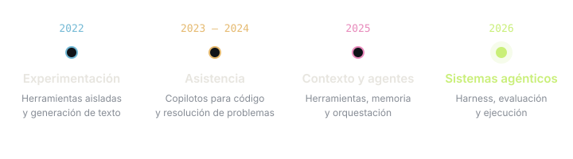
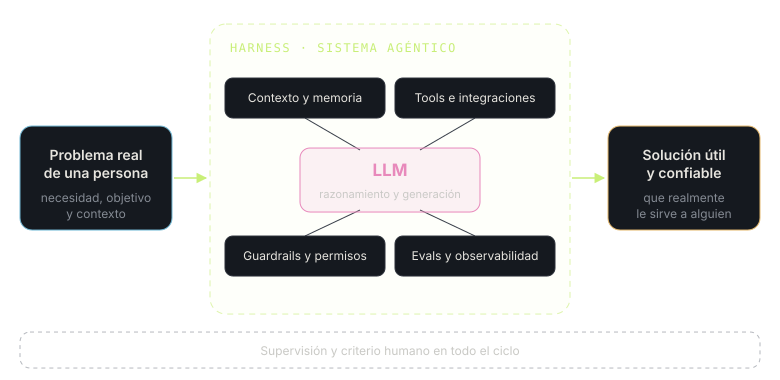
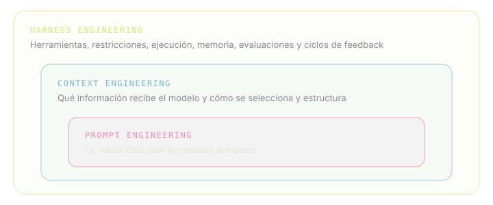

# Entre Transformers y emociones: reflexiones en tiempos de IA

## Una pequeña herramienta que parecía increíble

La inteligencia artificial ha avanzado a pasos agigantados. Es curioso mirar hacia atrás y pensar en lo mucho que han cambiado las cosas en apenas cuatro años.

Todavía recuerdo que, en 2022, cuando estaba en la universidad, tuvimos que preparar un *elevator pitch* para un curso de innovación. El típico discurso de un minuto en el que tienes que presentar y vender una idea.

En ese entonces, con mis compañeros encontramos una herramienta de inteligencia artificial que generaba estos discursos. Le entregabas una idea y te ayudaba a estructurar cómo presentarla.

Recuerdo que nos pareció increíble.

La herramienta no era especialmente buena. Sus resultados eran bastante genéricos, muchas veces imprecisos, pero servía para orientarnos y encontrar una estructura para lo que queríamos comunicar. Y eso, en aquel momento, ya era sorprendente.

Por esos años yo estaba bastante interesado en el procesamiento de lenguaje natural, o NLP. Había tenido cursos en la universidad donde aprendimos sobre algoritmos clásicos, redes neuronales y distintas técnicas para procesar texto. Aunque recuerdo que no profundizamos demasiado en la arquitectura Transformer.

También comenzaban a popularizarse los primeros modelos de generación de imágenes, como Stable Diffusion. Recuerdo que podías descargarlos, ejecutarlos en Google Colab e incluso hacer *fine-tuning* con tus propias fotografías para generar imágenes de ti mismo.

Los resultados eran bastante imperfectos. Muchas veces las imágenes no se parecían demasiado a lo que esperabas, pero la posibilidad de generar algo completamente nuevo a partir de una descripción era fascinante.

Y entonces llegó ChatGPT.

## Cuando conversar con una IA todavía parecía ciencia ficción

A finales de noviembre de 2022 se lanzó ChatGPT, inicialmente basado en GPT-3.5.

Recuerdo particularmente un video de [DotCSV](https://www.youtube.com/@DotCSV), un divulgador español de inteligencia artificial al que sigo desde hace años. En ese video mostraba lo sorprendente que resultaba interactuar con ChatGPT, darle instrucciones, asignarle una personalidad o pedirle que simulara comportarse como una terminal.

Puede parecer algo muy sencillo hoy, pero en ese entonces era impresionante.

Lo curioso es que muchas de esas capacidades que nos sorprendían hace apenas unos años hoy las damos por sentadas.

Ya no nos sorprende que un modelo pueda interpretar una instrucción, escribir código, analizar un documento o mantener una conversación relativamente compleja.

Y quizás eso es lo que más me llama la atención: **la velocidad con la que algo extraordinario se convierte en algo cotidiano.**

## De escribir código con ayuda de IA a construir proyectos completos

Durante 2023 y 2024, en mis primeros trabajos como Data Scientist, comencé a incorporar cada vez más estas herramientas en mi día a día.

Seguía dedicando bastante tiempo a programar, investigar y resolver problemas. La IA era principalmente una herramienta de apoyo: me ayudaba a escribir fragmentos de código, explorar alternativas, encontrar errores o plantear soluciones.

Pero todavía había una distancia importante entre pedirle ayuda a un modelo y delegarle la construcción de una solución completa.

Hoy esa distancia se ha reducido enormemente.

Los modelos actuales pueden construir proyectos completos, desarrollar frontend y backend, proponer arquitecturas, incorporar patrones de diseño y aplicar buenas prácticas de ingeniería de software.

Por supuesto, no significa que siempre lo hagan bien.

Desde mi perspectiva, los modelos anteriores tenían muchas más dificultades para incorporar buenas prácticas de manera consistente. Hoy son bastante mejores, aunque todavía necesitan orientación, revisión y criterio técnico.

En mi trabajo actual, por ejemplo, construyo agentes de inteligencia artificial. Y resulta interesante cómo ha cambiado la naturaleza de ese trabajo.

Cada vez dedico más atención a que los sistemas funcionen correctamente: las integraciones, el backend, la arquitectura, la observabilidad, la latencia, la confiabilidad y la manera en que estos agentes interactúan con otros sistemas.

Mientras tanto, una parte importante del comportamiento del agente puede definirse mediante instrucciones en lenguaje natural.

Es una transformación enorme.

Antes, construir ciertas funcionalidades significaba implementar explícitamente una gran cantidad de lógica. Hoy, en algunos casos, basta con describir qué comportamiento esperamos y proporcionar las herramientas y el contexto adecuados.

Eso no elimina la ingeniería. Creo que, más bien, **desplaza una parte importante del esfuerzo hacia el diseño del sistema que rodea al modelo.**

## Del prompt engineering al context engineering y al harness engineering

Hay algo que me parece especialmente curioso de esta evolución.

Hace algunos años se hablaba muchísimo del *prompt engineering*. Incluso se planteaba como una posible profesión del futuro.

Hoy siento que la idea de que escribir prompts sofisticados, por sí solo, constituiría una gran especialidad ha perdido bastante fuerza.

No significa que las instrucciones hayan dejado de importar. Siguen siendo fundamentales, pero el problema se ha vuelto mucho más amplio.

Comenzamos a hablar de *context engineering*: cómo seleccionar, estructurar y administrar la información que recibe un modelo para que pueda resolver correctamente una tarea.

Y más recientemente, de *harness engineering*: cómo diseñar el entorno que rodea al modelo, las herramientas que utiliza, las restricciones, los mecanismos de ejecución, la memoria, las evaluaciones y los ciclos de retroalimentación.

Me parece fascinante observar esta evolución.

En tan poco tiempo hemos pasado de preocuparnos principalmente por cómo formular una instrucción a diseñar sistemas completos alrededor de modelos cada vez más capaces.

Y probablemente esto seguirá cambiando.

## Agradezco haber aprendido los fundamentos

Hay algo que agradezco mucho de haber estudiado ciencia de datos y machine learning antes de esta explosión de herramientas: haber tenido la oportunidad de comprender sus fundamentos.

Entender qué es una red neuronal, cómo funciona el entrenamiento, qué significa optimizar una función de pérdida o cómo opera la arquitectura Transformer me permite mirar estas tecnologías con una perspectiva diferente.

Por supuesto, los modelos actuales son sistemas muchísimo más complejos que una arquitectura aislada. Pero los Transformers siguen siendo una pieza central de muchos de los grandes modelos de lenguaje.

También ha sido interesante observar cómo ha evolucionado nuestra comprensión del escalamiento.

Desde las [*scaling laws*](https://arxiv.org/abs/2001.08361) y trabajos como [Chinchilla](https://arxiv.org/abs/2203.15556), que ayudaron a entender mejor la relación entre cómputo, datos y tamaño del modelo, hasta los avances más recientes relacionados con el uso de cómputo durante la inferencia, o *test-time compute*.

Hay muchísimo detrás de algo que, para el usuario final, puede parecer tan sencillo como escribir una pregunta y recibir una respuesta.

Y creo que entender al menos parte de esos fundamentos es valioso.

No necesariamente porque todos debamos investigar o entrenar modelos desde cero, sino porque nos ayuda a desarrollar criterio para comprender sus capacidades, limitaciones y posibles errores.

## Estoy escribiendo este artículo sin escribirlo

Hay una ironía bastante interesante en todo esto.

Mientras comparto estas reflexiones, no estoy sentado frente a un editor escribiendo cuidadosamente cada párrafo.

Estoy hablando.

Estoy grabando un audio, expresando mis ideas de manera espontánea, y utilizando inteligencia artificial para convertirlas en un texto con mayor coherencia y cohesión.

Podría haber dedicado varias horas a escribir, ordenar las ideas, revisar la gramática y encontrar la mejor manera de conectar los distintos temas.

Pero hoy puedo simplemente hablar.

Los modelos de reconocimiento de voz permiten transcribir lo que digo, y un modelo de lenguaje puede ayudarme a estructurar estas reflexiones sin que necesariamente pierdan su sentido original.

La reducción de fricción es enorme.

A veces pienso que podría escribir un libro completo sobre mi vida y mis experiencias simplemente conversando, grabando mis recuerdos y utilizando estas herramientas para organizar el contenido.

Y eso me parece increíble.

Porque, más allá de automatizar tareas, la IA también está cambiando la manera en que podemos expresar nuestras ideas y convertirlas en algo tangible.

## El privilegio de trabajar con estas herramientas

Creo que quienes trabajamos en tecnología, particularmente en inteligencia artificial y desarrollo de software, estamos viviendo una etapa privilegiada.

Tenemos acceso a herramientas que nos permiten aprender más rápido, experimentar, construir soluciones y resolver problemas con una velocidad que hace algunos años habría sido difícil imaginar.

Personalmente, siento que estas herramientas me han permitido ser más eficiente y, en cierta medida, mejorar mi calidad de vida.

Aunque aquí también hay una contradicción interesante.

Ser más productivo no necesariamente significa trabajar menos.

Cuando podemos hacer las cosas más rápido, también pueden aumentar las expectativas sobre cuánto somos capaces de producir. Dependiendo de cómo comuniquemos y gestionemos esa productividad, podemos terminar asumiendo una carga laboral todavía mayor.

Creo que es una dinámica que debemos aprender a manejar.

La tecnología puede darnos más tiempo y libertad, pero no necesariamente lo hará por sí sola.

## Construir más rápido no significa construir mejor

También hay algo que me genera cierta inquietud.

Hoy es extraordinariamente sencillo generar código, artículos, imágenes, aplicaciones y prácticamente cualquier tipo de contenido.

Pero esa facilidad también ha dado lugar a una enorme cantidad de contenido de baja calidad, lo que muchas veces se denomina *AI slop*.

Y me surge una pregunta que todavía no tengo completamente resuelta:

**¿Qué ocurre cuando comenzamos a generar contenido con modelos entrenados, a su vez, con cantidades crecientes de contenido generado por otros modelos?**

¿Existe el riesgo de que la calidad se deteriore progresivamente? ¿De que terminemos amplificando errores, perdiendo diversidad o reproduciendo patrones cada vez más homogéneos?

Es algo que me gustaría investigar con mayor profundidad.

Y es curioso porque podría pedirle a una IA que investigara esa misma pregunta por mí.

Creo que ahí aparece otro desafío importante: aprender a utilizar estas herramientas sin abandonar nuestra propia capacidad de pensar, cuestionar y comprender.

En programación, por ejemplo, me parece fundamental no perder el hábito de entender las bases, revisar el código, cuestionar las decisiones de arquitectura y comprender por qué algo funciona.

Delegar la implementación puede ser tremendamente útil.

Delegar completamente el criterio es otra cosa.

## Disfrutar, aprovechar y seguir aprendiendo

Actualmente estoy reconstruyendo mi sitio personal utilizando herramientas de desarrollo asistidas por inteligencia artificial.

Y mientras lo hago, no puedo evitar pensar que probablemente dentro de un año estaremos utilizando modelos todavía más capaces.

Quizás muchas de las limitaciones que hoy enfrentamos nos parecerán triviales.

Es difícil anticipar hasta dónde llegará todo esto.

Podríamos dedicar muchísimo tiempo a analizar cómo la IA está transformando distintas profesiones, qué trabajos cambiarán, cuáles desaparecerán y qué nuevas oportunidades surgirán.

Son preguntas importantes y que merecen una discusión profunda.

Pero en esta etapa, personalmente, estoy tratando de adoptar una perspectiva más sencilla: **disfrutar, aprovechar y agradecer la oportunidad de vivir esta transformación.**

Me gusta resolver problemas.

Me gusta trabajar con personas, entender sus necesidades, conocer sus dificultades y encontrar maneras de ayudarlas mediante la tecnología.

Y creo que la inteligencia artificial es una herramienta extraordinaria para eso.

Al final, más allá de los modelos, los frameworks y las arquitecturas, lo que me sigue motivando es la posibilidad de construir algo que realmente le sirva a alguien.

## No olvidemos que somos humanos

Quiero terminar con una reflexión un poco distinta.

A medida que los modelos se vuelven más capaces de realizar tareas intelectuales, razonar sobre problemas y ayudarnos a tomar decisiones, me parece importante recordar que nuestra experiencia humana va mucho más allá de la capacidad de procesar información.

Nuestro cerebro es extraordinariamente complejo. La corteza prefrontal participa en procesos relacionados con la planificación y el control cognitivo, mientras que estructuras como la amígdala cumplen funciones importantes en el procesamiento emocional.

Por supuesto, la relación entre emoción y razón es mucho más compleja que una simple división entre dos regiones del cerebro.

Pero me interesa esa idea de que nuestra experiencia está profundamente marcada por la interacción entre lo que pensamos y lo que sentimos.

Podemos intentar explicar el amor mediante procesos biológicos, reacciones químicas o patrones de comportamiento.

Y seguramente encontraremos explicaciones cada vez más sofisticadas.

Pero una cosa es explicar conceptualmente una emoción y otra es vivirla.

Sentir cariño por alguien. Enamorarse. Extrañar. Compartir una conversación. Reírse con amigos. Abrazar a una persona que queremos.

Sentir que estamos vivos.

Creo que ahí hay algo profundamente valioso.

La inteligencia artificial puede ayudarnos a resolver problemas, ampliar nuestras capacidades y liberar tiempo para otras actividades.

Pero espero que, en medio de esta aceleración tecnológica, no olvidemos dedicar parte de ese tiempo a vivir.

A conectar con otras personas, expresar emociones, entregar cariño y disfrutar de las experiencias que hacen que la vida tenga sentido.

Porque quizás una de las mayores oportunidades que nos entrega esta tecnología no sea simplemente producir más.

**Quizás sea tener más espacio para aquello que realmente nos importa.**

Y, al menos para mí, eso sigue estando profundamente relacionado con las personas.

Con sentir, compartir y amar.
